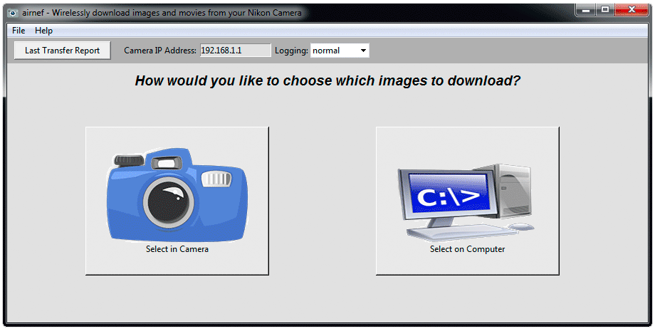

# Airnef

Wireless file transfer for PTP/MTP-equipped cameras (Nikon, Canon, Sony) over WiFi (PTP/IP, port 15740).

## Description

Airnef is two applications - a GUI front-end and a command-line app. The GUI front-end allows you to visually select the criteria of which images to download and then launches the command-line app to perform the transfer. You can optionally use the command-line version directly to script your transfers.

## Major Features

- One-button click to download all new images and video from the camera, selected on either the camera or computer by criteria
- Fast downloads - Airnef uses optimized Media Transfer Protocol (MTP) parameters for sustained throughput around 2.5 MB/s
- Realtime download mode - images are transferred to your computer as you shoot them. For cameras without realtime WiFi shooting support an optional staged-realtime process can be used as well.
- Extensive criteria selection makes it easy to quickly choose which images to download, including by file type (NEF, JPG, MOV, etc...), starting and/or ending capture date, specific camera folders, and media card slot - in any combination. And Airnef will automatically skip over files you've already downloaded!
- Renaming engine allows you to customize the names of directories and files for images you download
- Download exec feature lets you launch your favorite image viewing or editing application for each file downloaded
- Advanced local caching of MTP metadata allows for very fast click-to-download start times
- Lets you decide the order that files are downloaded, either oldest first or newest first. That way you can start working on the files you want right away instead of waiting for all the files to be downloaded
- Fault-tolerant operation - Airnef will continuously retry any failed communication/transfer, resuming the download exactly where it left off, even in the middle of a file. This is important when downloading very large video files on marginal wireless connections



## Camera Support Feature Matrix

This is a partial list of camera's I've personally tested. Even if your camera is not listed it may still work.

| **Camera** | **Select Images in Camera** | **Select Images on Computer** | **Realtime Download[^1]** |
|---|---|---|---|
| All Nikon cameras built-in WiFi | Yes | Yes | All DSLRs[^2] |
| All Nikon cameras with WU-1a/WU-1b Adapter | No[^3] | Yes | Yes |
| All Canon Cameras with WiFi | No | Yes | Yes |
| All Sony Cameras with WiFi | No | Yes | Staged Realtime[^4] |
| Nikon D750, D7200 | Yes | Yes | Yes |
| Nikon J4, J5 | Yes | Yes | Staged Realtime[^4] |
| Canon 6D | Yes | Yes | Yes |

[^1]: An easy way to tell if your camera supports Realtime Download is if it allows you to take photographs while its WiFi interface is enabled and in the mode required by Airnef. For example most Nikon DSLRs support shooting with WiFi enabled. In contrast, Sony cameras (in the Send to Computer mode) and the Nikon J4/J5 require you to leave the WiFi mode before you can use the functionality of the camera again  
[^2]: Nikon 1 cameras with built-in WiFi such as the J4 and J5 do not support Realtime download but can use staged realtime transfers  
[^3]: Nikon bodies using an external WU-1a or WU-1b WiFi adapter have no separate menu option for selecting images to upload and the alternate mechanism of selecting images for upload in the playback menu (present in cameras with native WiFi support like the D7200) is unavailable because the playback menu is disabled when WiFi is on for cameras with an external WiFi adapter.  
[^4]: Staged Realtime means the camera doesn't support taking photographs while in the WiFi mode required by Airnef but you can achieve faux-realtime transfers by shooting any number of photos in non-WiFi mode then turning your camera's WiFi on to automatically transfer those images to Airnef, then turn your camera's WiFi back off to resume shooting. You can repeat this any number of times while running a single Airnef session (no intervention required on computer). More details: [Realtime Downloads](docs/user-guide.md#realtime-downloads).

## Documentation

| Document | Content |
|---|---|
| [docs/installation.md](docs/installation.md) | Windows, OS X, Linux, and running from Python source |
| [docs/camera-setup.md](docs/camera-setup.md) | One-time setup for Nikon, SnapBridge, Sony and Canon; WiFi performance tips |
| [docs/user-guide.md](docs/user-guide.md) | GUI guide, Realtime Downloads, Download Exec |
| [docs/renaming-engine.md](docs/renaming-engine.md) | `--filenamespec` / `--dirnamespec`: specifiers, subscripts, options |
| [docs/command-line-reference.md](docs/command-line-reference.md) | All `airnefcmd` arguments, including hidden debug arguments |
| [docs/faq.md](docs/faq.md) | Frequently asked questions |

## Source Layout

| File | Role |
|---|---|
| `airnef.pyw` | GUI (Tkinter) - builds the command line and launches `airnefcmd` |
| `airnefcmd.py` | Command-line app: session, object enumeration, cache, download, realtime, retry |
| `mtpwifi.py` | PTP/IP transport (TCP 15740): Init Command/Event, Probe, packet send/receive |
| `mtpdef.py` | PTP/MTP constants (opcodes, responses, events, device props) incl. Nikon/Canon/Sony vendor codes |
| `ssdp.py` | SSDP discovery (`--ipaddress auto`) for Sony/Canon |
| `rename.py` | Rename engine |
| `applog.py`, `strutil.py`, `dlinkedlist.py` | Logging, string/hexdump helpers, capture-date sorted linked list |
| `airnefcmd_OSX_Frozen_Wrapper.py` | Wrapper that runs airnefcmd inside the frozen OS X app |
| `tests/` | pytest suite; `tests/ptpip_sim.py` is a simulated PTP/IP camera (CIPA DC-005) |

## Development

Requires Python 3.12+ and [uv](https://docs.astral.sh/uv/). The project pins Python 3.15 in `.python-version`.

```bash
uv sync                      # create .venv with the locked dependencies
uv run pytest                # run the test suite against the simulated camera
uv run airnefcmd.py --help   # command-line app
uv run airnef.pyw            # GUI
```

The test suite needs no camera: `tests/ptpip_sim.py` implements the PTP/IP responder side
(two TCP connections, Init Command/Event handshake, data phases, events, probes) and
serves a small in-memory card that `airnefcmd.py` downloads from.

## Features Planned for Next Release

- A fully self-contained GUI app with visual selection of images to download
- Potential support for DslrDashboardServer

## Developer Notes

For anyone interested in the ongoing progress of Airnef development, I've created a developer notes page.

## Credits

- Special thanks to Joe FitzPatrick for his work on reverse-engineering Nikon's WiFi interface
- Thanks to Wingware for their support of the open-source community. I plan to start using their Python IDE/debugger to help with future Airnet development.
- Camera bitmap courtesy of 'rg1024'
- Computer bitmap courtesy of 'lnasto'
- WiFi icons/bitmaps courtesy of 'neorg' and 'MrTossum'
- Camera Icon courtesy of 'Paomedia', licensed under Creative Commons (Attribution 3.0 Unported)

## License

```text
    airnef - Wirelessly download images and movies from your Nikon Camera
    Copyright (C) 2015, testcams.com
    This program is free software: you can redistribute it and/or modify
    it under the terms of the GNU General Public License as published by
    the Free Software Foundation, either version 3 of the License, or
    (at your option) any later version.
    This program is distributed in the hope that it will be useful,
    but WITHOUT ANY WARRANTY; without even the implied warranty of
    MERCHANTABILITY or FITNESS FOR A PARTICULAR PURPOSE.  See the
    GNU General Public License for more details.
    You should have received a copy of the GNU General Public License
    along with this program.  If not, see <http://www.gnu.org/licenses/>.
```
